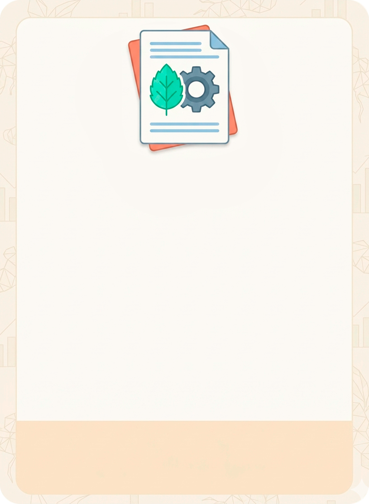
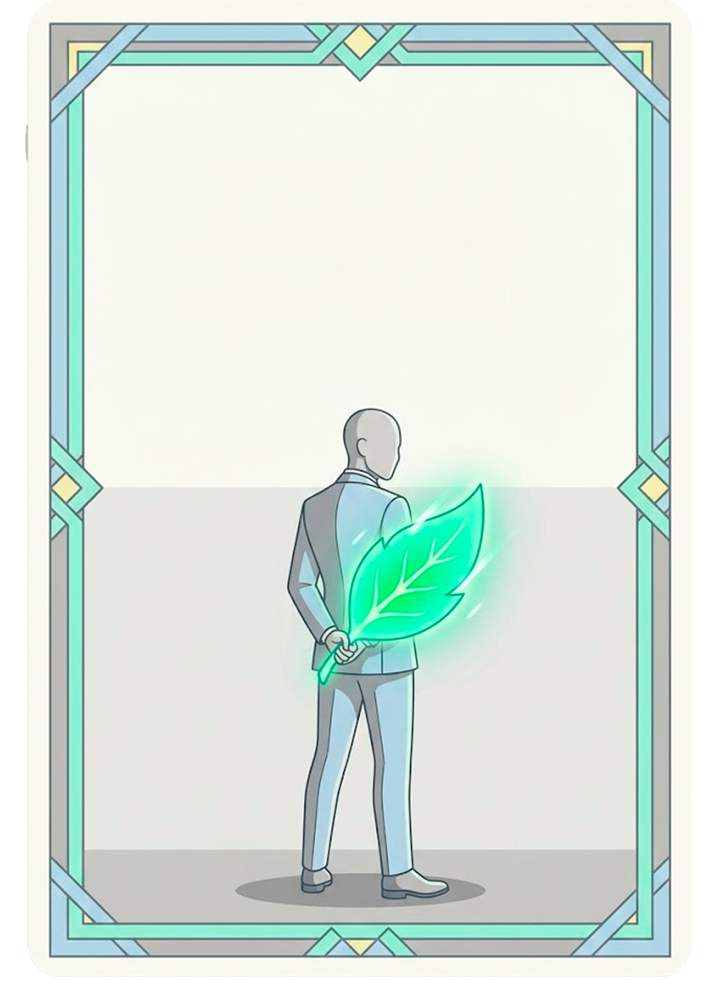
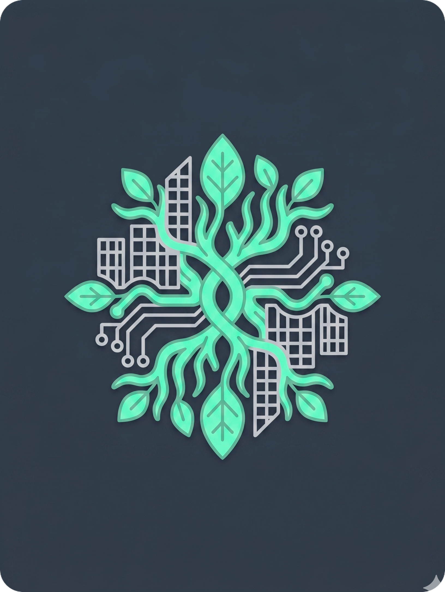

# 🌱 Rhizome: A Rota do Sistema


**Rhizome** é um jogo digital de dedução social e educação ambiental crítica projetado para ser jogado presencialmente com um único dispositivo (estilo *pass-and-play*). O aplicativo atua como o mestre da partida, gerenciando identidades, o baralho de projetos, o tempo de plenária e a pontuação, funcionando 100% offline através da tecnologia PWA.

---

### 🌐 Jogue Agora (Demo Online)

> 🚀 **Acesse a aplicação em produção:**  
> 👉 **[https://rhizome-rp11.netlify.app](https://rhizome-rp11.netlify.app/)**  
> *(Dica: para uma experiência fiel à proposta do jogo, acesse pelo smartphone ou ative o modo responsivo mobile nas ferramentas de desenvolvedor do navegador).*

---

## 📱 Demonstração e Telas

<div align="center">

| Tela Inicial & Identidade | Revelação de Papel Secreto | Seleção de Projetos |
| :---: | :---: | :---: |
|  |  |  |

*(Insira aqui um GIF de gameplay em ação demonstrando a passagem do aparelho entre os jogadores)*
</div>

---

## 🎯 Objetivo do Jogo

O jogo é um embate político e ideológico entre duas facções que dividem a mesma mesa. O objetivo de ambas as facções é ser a primeira a **aprovar 5 cartas (projetos) do seu alinhamento**.

### 👥 As Facções
* **A Comunidade (Maioria):** Representam os cidadãos, ativistas e trabalhadores locais. Eles jogam "no escuro", não sabem quem são os seus aliados e precisam usar a dedução para aprovar 5 projetos sustentáveis do tipo `COMUNIDADE`.
* **A Corporação (Minoria Infiltrada):** Representam os interesses de megacorporações, do agronegócio predatório e da elite econômica. Eles jogam com vantagem: abrem os olhos no início do jogo e sabem exatamente quem são os outros Executivos. Precisam manipular os debates e mentir para aprovar 5 projetos da Corporação.

---

## 📖 Como Jogar (Dinâmica da Rodada)

Rhizome é jogado em sucessivas rodadas compostas pelas seguintes fases:

1. **Seleção de Governo:** O app indica quem é o **Líder** da rodada. O Líder deve escolher verbalmente um **Conselheiro** entre os outros jogadores.
2. **Votação Pública:** Todos os jogadores debatem se confiam nessa dupla. O Líder insere no app se a mesa aprovou ou rejeitou o governo.
3. **O Caos:** Se a mesa rejeitar 3 governos consecutivos (termômetro do caos), a sociedade entra em colapso. O app saca a carta do topo do baralho e a aprova automaticamente, sem chance de defesa! Se o caos não acontecer, o governo segue para a fase legislativa.
4. **Fase Legislativa (O Pulo do Gato):**
   * O **Líder** recebe 3 cartas secretas do app. Ele deve remover 1 e passar o celular para o Conselheiro com as 2 restantes.
   * O **Conselheiro** recebe as 2 cartas do Líder, remove 1 e aprova a carta final.
5. **Plenária:** Um cronômetro entra em cena para o tempo de defesa. O Líder e o Conselheiro precisam justificar para a mesa por que aquela carta foi aprovada (e se alguém mentiu sobre as cartas que recebeu).
6. **Pontuação:** O app revela a carta para todos, processa o ponto para a Comunidade ou para a Corporação, e passa a coroa para o próximo Líder.

---

## ⚠️ Regras Gerais e Faixa Etária

* **Número de Jogadores:** 5 a 10 jogadores. (O app balanceia automaticamente a quantidade de Executivos dependendo do número de pessoas na mesa).
* **Faixa Etária Recomendada:** **14+ anos.** O jogo exige capacidade de argumentação, blefe e lida com temas densos do mundo real (ex: gentrificação, agronegócio, cooperativas, concessões ambientais).
* **O Celular:** O dispositivo deve sempre ser passado virado para baixo. É estritamente proibido mostrar a tela do seu celular para outro jogador durante as fases secretas.

---

## 🧠 Decisões Técnicas e Arquitetura

O projeto foi concebido sob princípios rigorosos de usabilidade em campo, confiabilidade algorítmica e autonomia de rede:

### 1. Filosofia *Offline-First* com PWA
* **O problema:** Jogos de dedução social e de tabuleiro são tipicamente jogados em reuniões presenciais, encontros de amigos, salas de aula ou acampamentos — locais onde o sinal de Wi-Fi ou rede móvel costuma ser fraco, saturado ou inexistente. Depender de requisições de rede para carregar regras ou rodadas arruinaria a fluidez da partida.
* **A solução:** Toda a base de conhecimento (as 500 cartas em JSON) e os assets visuais (imagens WebP otimizadas e fontes) são embarcados na aplicação e geridos via `vite-plugin-pwa` com Workbox. A estratégia de cache `CacheFirst` garante que, após o primeiro acesso, o aplicativo abre instantaneamente e roda 100% desconectado da internet, além de poder ser instalado na tela inicial como um app nativo (*standalone*).

### 2. Imparcialidade Algorítmica com Fisher-Yates (Knuth Shuffle)
* **O problema:** Em jogos de blefe e papéis ocultos, qualquer viés estatístico destrói o balanceamento da partida. Abordagens populares e ingênuas em JavaScript, como `array.sort(() => Math.random() - 0.5)`, são matematicamente viciadas — produzem distribuições desiguais (certas permutações são mais prováveis que outras) e operam em complexidade $O(N \log N)$.
* **A solução:** Implementamos o algoritmo clássico de **Fisher-Yates** em tempo linear $O(N)$ e espaço $O(1)$ *in-place*. Ele é utilizado em dois momentos centrais do `gameService`:
  1. **Distribuição Secreta de Facções:** Garante que a atribuição de papéis (Comunidade vs Corporação) seja estritamente equiprovável entre todos os participantes.
  2. **Embaralhamento do Baralho Legislativo:** Assegura que o sorteio das cartas enviadas à mesa não sofra vícios de proximidade ou repetição no array de dados.

### 3. Conectividade Híbrida P2P (PeerJS / WebRTC)
* Além do modo padrão *pass-and-play* no mesmo dispositivo, a aplicação dispõe de arquitetura P2P usando **PeerJS**. A sincronização de salas e estados entre múltiplos celulares ocorre diretamente entre os navegadores via WebRTC, eliminando custos de infraestrutura de backend em tempo real e mantendo a descentralização do jogo.

---

## 🗄️ O Banco de Dados (Cartas)

Toda a base de conhecimento e as leis do jogo derivam do arquivo `src/database/cards_data.json`.
Ele contém **500 cartas exclusivas** que abordam tensões reais do Brasil e do mundo, divididas entre projetos comunitários e interesses corporativos.

Cada carta (projeto) possui a seguinte estrutura:
```json
{
  "id": "c001",
  "title": "Corredores Agroecológicos Populares",
  "description": "Criação de redes agroecológicas geridas por cooperativas camponesas para abastecimento...",
  "type": "COMUNIDADE", // Define se a carta dá ponto para a Comunidade ou para a Corporação
  "categorie": "Agricultura",
  "region": "Nordeste"
}
```

*(Nota técnica: o atributo `type` e o papel dos jogadores no código-fonte podem manter internamente a nomenclatura legada `"lobby"` por motivos de retrocompatibilidade com o motor de jogo, sendo traduzida na interface visual para "Corporação").*

---

## 🧪 Estratégia de Qualidade e Testes

A integridade do software é garantida em múltiplas camadas, indo além dos testes de build:

### 1. Testes de Regra de Negócio e Lógica de Jogo
* **Balanceamento de Facções:** Validação das regras de proporção de jogadores em `generatePlayersFunction` (garantindo que mesas de 5 a 6 jogadores tenham exatamente 2 executivos, 7 a 8 tenham 3, e 9 a 10 tenham 4).
* **Unicidade de Identidades:** Verificação de geração de identificadores únicos via `crypto.randomUUID()` para cada jogador por partida.
* **Integridade do Baralho:** Validação de que a extração de cartas pelo Fisher-Yates retira IDs válidos sem duplicações nas 3 opções da rodada legislativa.

### 2. Esteira Automatizada de CI/CD (GitHub Actions)
* **Verificação Estática de Tipos:** Execução de `npx tsc --noEmit` para validação rigorosa de tipagem estática no TypeScript em todo PR e push para a branch `develop`.
* **Teste de Build Automatizado:** Execução do pipeline de compilação e empacotamento com Vite (`npm run build`), assegurando que nenhum commit com erros de empacotamento alcance o repositório principal.
* **Guardião da Master (Branch Protection):** Workflow dedicado que bloqueia pull requests diretos para a branch `master` se não forem provenientes de `develop` ou branches de `hotfix/*`.
* **Qualidade de Código e Linting:** Padronização com ESLint e formatação consistente via Prettier.

### 3. Validação de Usabilidade e Resiliência Offline
* **Auditoria de PWA:** Testes periódicos com Lighthouse e inspeção do Application Cache no DevTools, garantindo que Service Workers sirvam os assets mesmo com a rede forçada em modo *Offline*.
* **Testes de Experiência Mobile:** Validação de gestos de toque, transições do Framer Motion e legibilidade em múltiplos formatos de viewport de smartphones.

---

## 💻 Tecnologias e Stack

* **Frontend:** [React](https://react.dev/) + [TypeScript](https://www.typescriptlang.org/) (via [Vite](https://vitejs.dev/))
* **Estilização:** [Tailwind CSS](https://tailwindcss.com/)
* **Animações e Física:** [Framer Motion](https://www.framer.com/motion/) (interações fluidas de cartas e transições modais)
* **Roteamento:** [React Router](https://reactrouter.com/)
* **PWA & Offline:** [vite-plugin-pwa](https://vite-pwa-org.netlify.app/) + Workbox
* **Multiplayer P2P:** [PeerJS](https://peerjs.com/) (WebRTC)
* **CI/CD:** [GitHub Actions](https://github.com/features/actions)

---

## 🛠️ Como rodar o projeto localmente

Siga as instruções abaixo para contribuir ou testar o jogo em sua máquina:

1. **Clone o repositório**
```bash
git clone https://github.com/rhianpablo11/rhizome_root_of_system.git
```

2. **Acesse a pasta da aplicação**
```bash
cd rhizome_root_of_system/rhizome_app
```

3. **Instale as dependências**
```bash
npm install
```

4. **Inicie o servidor de desenvolvimento**
```bash
npm run dev
```

5. O aplicativo estará rodando em `http://localhost:5173`. Para simular a experiência real do jogo, abra o *DevTools* do navegador (`F12`) e alterne para a visualização responsiva mobile.

---

## 👥 Autores & Créditos

Projeto concebido e desenvolvido em colaboração por:

<div align='center'>

| [<br /><sub><b>Rhian Pablo</b></sub>](https://github.com/rhianpablo11) | [<br /><sub><b>Márcio Roberto</b></sub>](https://github.com/MarcioDzn) |
| :---: | :---: |
| [](https://github.com/rhianpablo11) | [](https://github.com/MarcioDzn) |
|  |   |
</div>

---

**Desenvolvido com ☕, código e reflexão crítica.** 🌿
